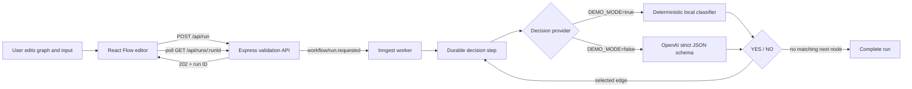

# Branchline — Visual AI Workflow Studio

Branchline is a visual workflow builder for developers and operations teams who want to route a message through a small sequence of binary decisions. A decision node returns **YES** or **NO**; the selected branch determines the next node. The editor uses React Flow, the API validates and queues work, Inngest runs each visited decision as a durable step, and the OpenAI SDK can provide strict-schema model decisions.

## Run locally

Requirements: Node.js 20.19+ (or 22.12+) and npm. Install packages once:

```bash
npm install
```

Copy `.env.example` to `.env`. The app starts in clearly labelled **demo mode** unless `OPENAI_API_KEY` is set and `DEMO_MODE=false`. For actual model decisions, edit `.env`:

```dotenv
OPENAI_API_KEY=your_key_here
OPENAI_MODEL=gpt-4o-mini
DEMO_MODE=false
PORT=3001
```

Open three terminals from this folder:

```bash
npm run dev          # Express API and Inngest function endpoint at :3001 (enables INNGEST_DEV)
npm run dev:inngest  # Inngest Dev Server, connected to the endpoint above
npm run dev:web      # Vite frontend at http://localhost:5173
```

The Inngest Dev Server UI is normally at `http://localhost:8288`. The exact address is printed in its terminal output.

## Try the workflow

The starter graph asks whether a message is support-related. YES leads to an urgency check; NO leads to a sales check. Select a node to edit its title or prompt. Drag from its green YES or gray NO handle to another node. Type a message in **Test input** and choose **Run workflow**. Follow the live run log and node/edge state; a path ends when its selected branch has no next node.

Each visited node is one durable Inngest `step.run`. The model is asked for a strict JSON object containing `decision: "YES" | "NO"`; API-side validation rejects any other shape/value. Inngest retries failed jobs twice and uses the run ID for idempotency; after retries, the run is marked failed and the UI identifies the failed node. Edit state auto-saves in the browser. The toolbar supports workflow JSON import/export.

### Example API request

The editor sends the current graph and input to `POST /api/run`. A request is accepted as a background job and returns HTTP `202` with a run ID; poll the status endpoint to read the decisions.

```json
{
  "input": "The checkout page crashes when I try to pay.",
  "graph": {
    "nodes": [
      { "id": "support", "type": "decision", "data": { "title": "Support request?", "prompt": "Is this message asking for product support?" } },
      { "id": "urgent", "type": "decision", "data": { "title": "Urgent issue?", "prompt": "Does the message describe an urgent outage or safety risk?" } }
    ],
    "edges": [
      { "id": "support-yes-urgent", "source": "support", "target": "urgent", "sourceHandle": "yes" }
    ]
  }
}
```

The editor is the simplest way to try a workflow: enter the same message in **Test input**, click **Run workflow**, then watch the node state and ordered log. The API can also be checked with `GET /api/health`; a successful health response names the active mode. The OpenAI mode requires a private server-side key.

## Architecture



The browser keeps the graph in local storage. The server validates the submitted graph, rejects invalid branches and cycles, and stores run state in memory for this MVP. Each reached node runs in its own Inngest step, then the matching outgoing edge selects the next decision.

### Demo mode

Demo mode uses a deterministic, keyword-based local decision function so the event queue, traversal, status polling, execution log, and visual state can be exercised without an API key. The UI and each run explicitly label this `DEMO`; it is not a model call and does not validate OpenAI connectivity. Use a real key with `DEMO_MODE=false` to exercise the OpenAI path. Do not put keys in frontend code or commit `.env`.

## API

| Endpoint | Purpose |
| --- | --- |
| `GET /api/health` | Check backend and report OpenAI or demo mode |
| `POST /api/run` | Validate graph, emit an Inngest event, return `202` with run ID |
| `GET /api/runs/:runId` | Poll queued/running/completed run state and decision log |
| `GET /api/inngest` | Inngest function registration and event execution endpoint |

## Project structure

```text
src/App.tsx                 React Flow editor, inspector, run log
src/components/             Custom decision node and Shadcn UI primitives
server.ts                   Express API, OpenAI structured output, Inngest worker
components.json             Shadcn UI configuration; Shadcn CLI is a dev dependency
vite.config.ts              React, Tailwind CSS v4, aliases, API proxy
.env.example                Environment variable template
```

## Current scope and limitations

- Single starting node; one incoming edge per decision; one destination per YES/NO output. The server rejects malformed or cyclic runs. Graph size is capped at 30 decisions.
- Run status is held in process memory for this learning MVP. It is lost if the API process restarts; use a persistent database before deployment.
- API keys are not included. Local demo mode is not evidence of an OpenAI call.
- This brief did not provide the FL-06 platform choice; React/Vite was selected because the assignment specifically requires React Flow. This is a recorded platform assumption, not a claim that it matches the missing FL-06 selection.

## Evaluation record (v2)

No formal v2 evaluation suite or scored test matrix was present in the project materials when this README was prepared. The evidence below is the observed local build and smoke run; it is not presented as a comprehensive model evaluation.

| Check | Observed result | Interpretation |
| --- | --- | --- |
| Production build | `npm run build` passed TypeScript checking and Vite bundling; 2,067 modules transformed. | Build verification only. |
| Local services | Frontend, API health endpoint, and Inngest Dev Server dashboard returned HTTP 200 during the recorded session. | Local availability check. |
| End-to-end run | Inngest accepted the job with HTTP 202; run `20f26825-5546-40a9-9eb9-507664185590` completed two demo steps: support request = YES, urgent issue = NO. | Successful traversal smoke test in **DEMO** mode. |
| OpenAI output quality | Not evaluated; no API key was configured and no OpenAI request was made. | Live-model quality remains unverified. |
| Failure/retry behavior | Retry configuration and failure callback are implemented; no failure-path result is claimed for this workflow build. | Needs a recorded failure-path evaluation. |

## AI and build transparency

AI assistance was used to help draft and implement application code and documentation. The author reviewed the project structure, corrected build errors, adjusted the demo classifier after inspecting its behavior, and checked the recorded build/run evidence. The successful workflow run used a deterministic demo classifier; it was not produced by an LLM. No OpenAI key or model result is included in this submission.

## Verify

```bash
npm run build
```

For an end-to-end live run, start all three processes, use a sample message, show the immediate run ID and the Inngest Dev Server function execution, then leave the recording unedited. The repository does not include or claim a screen recording.

For the narrated recording, follow [`DEMO_SCRIPT.md`](DEMO_SCRIPT.md). The current local run is demo mode; if you choose to demonstrate the real OpenAI path, configure the key privately and confirm the health endpoint reports `openai` before recording.

## Final package

See [`SUBMISSION_INDEX.md`](SUBMISSION_INDEX.md) for the capstone package index, checkpoint status, retrospective, and recording link status. [`RETROSPECTIVE.md`](RETROSPECTIVE.md) is a first-person draft for the author to review and personalize before submission.
